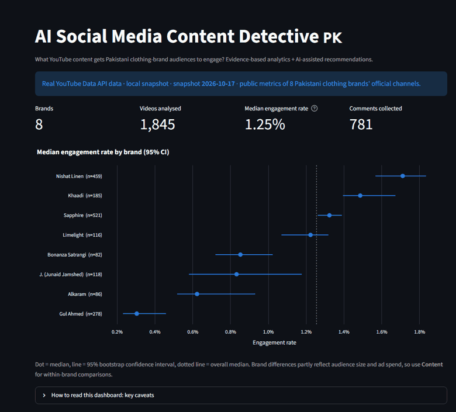
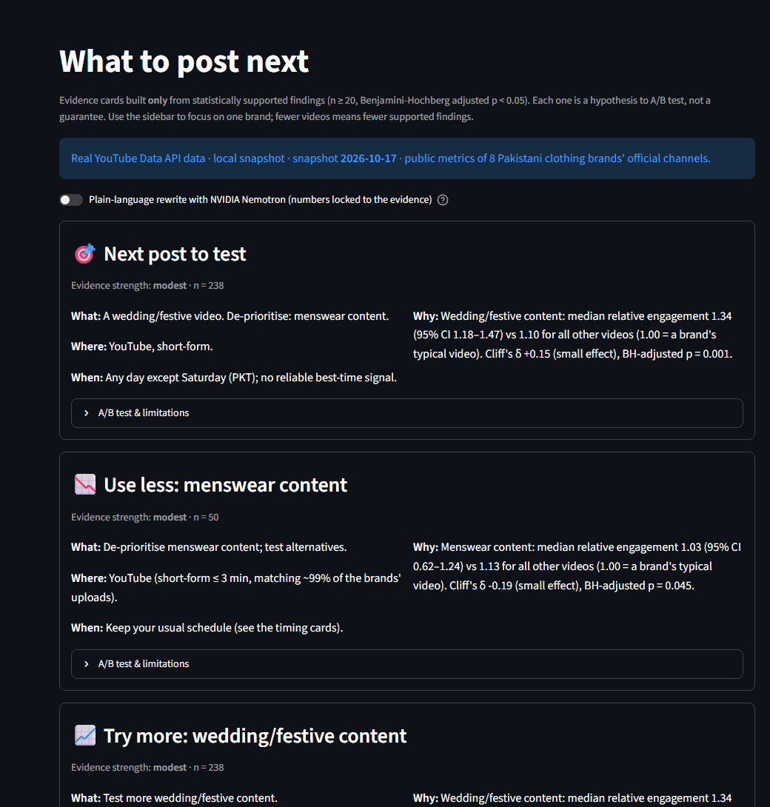
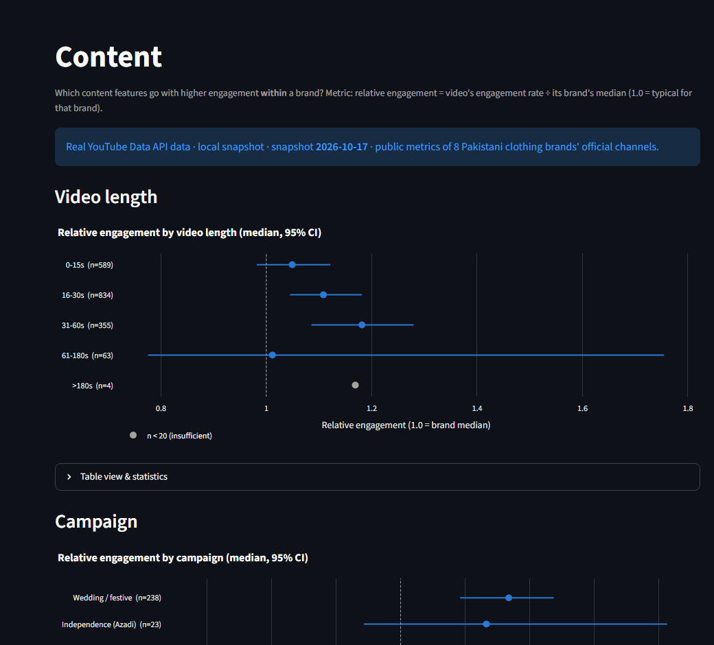
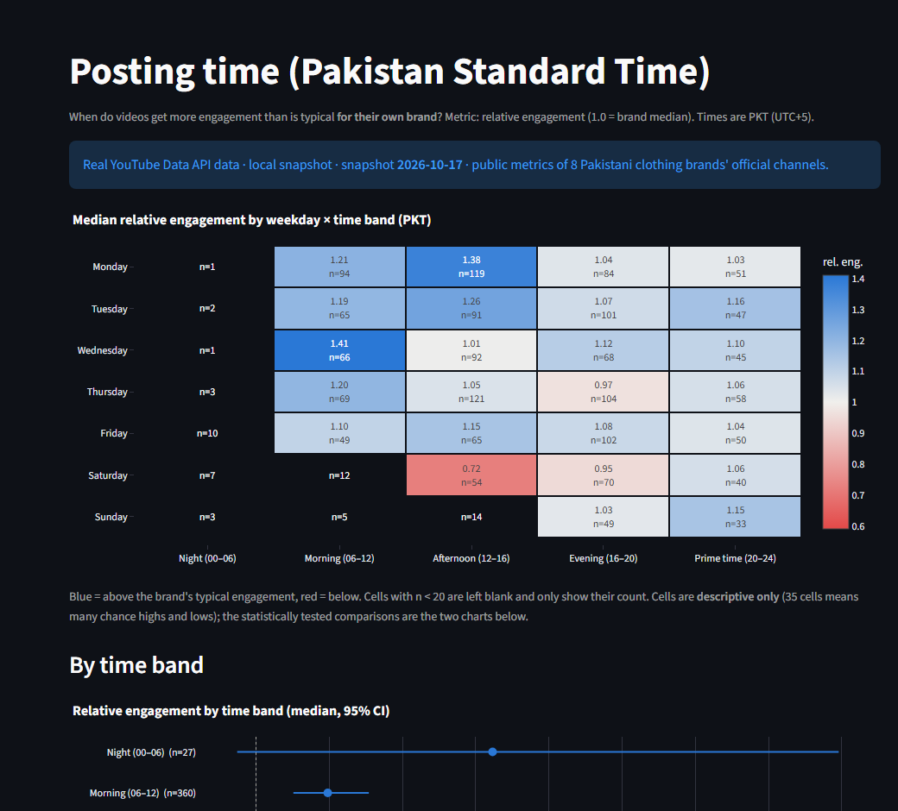

# AI Social Media Content Detective 🇵🇰

**What YouTube content gets Pakistani clothing-brand audiences to engage?**

An evidence-first analytics app that collects public YouTube data for 8 Pakistani clothing brands, measures engagement honestly, benchmarks multilingual sentiment models (English, Roman Urdu, Urdu), and turns only statistically supported findings into testable "what to post next" recommendations.

**Live app:** [https://pakistani-social-media-content-detective-mahmts48mya2xnxwgttip.streamlit.app](https://pakistani-social-media-content-detective-mahmts48mya2xnxwgttip.streamlit.app) · **Data:** YouTube Data API v3, refreshed weekly · **Stack:** Python 3.12, pandas, Streamlit, Plotly, scikit-learn, Hugging Face Transformers, NVIDIA API Catalog



## Key findings (snapshot 2026-10-17, 1,845 reliable non-promoted videos)

| Finding | Evidence | Effect size |
|---|---|---|
| **Wedding/festive** videos get more engagement than the same brand's other videos | median relative engagement 1.34 (95% CI 1.18–1.47) vs 1.10 for the rest, BH-adjusted p = 0.001 | small |
| **Saturday** uploads underperform | 0.93 (CI 0.82–1.02) vs 1.12, adj. p = 0.006 | small |
| **Menswear** content underperforms | 1.03 (CI 0.62–1.24) vs 1.13, adj. p = 0.045 | small |
| Hashtag count, video length, time of day, sale content | statistically detectable | negligible, so not recommended |
| **Engagement prediction** before publishing | gradient boosting / ridge lose to a single median on the newest 20% of videos | deferred |
| **Sentiment:** XLM-R multilingual (macro-F1 0.82) vs NVIDIA Nemotron LLM (0.87) | paired-bootstrap difference CI includes 0 | not significant |

Every number is reproducible from the code. Everything is associational, not causal.

## What makes it different

- **Honest metrics.** Within-brand *relative engagement* removes brand-size effects; ad-boosted ("likely promoted") videos are flagged and excluded by default; missing values stay null, never zero.
- **Real uncertainty.** Medians with bootstrap 95% CIs, Mann-Whitney + Cliff's δ, Benjamini-Hochberg correction, n ≥ 20 rule.
- **Measured NLP.** Language ID plus 6 sentiment approaches benchmarked on 250 real comments ([report](docs/NLP_BENCHMARK.md)).
- **Leakage-safe ML.** Chronological split, pre-publication features only, compared against two baselines ([report](docs/ML_EVALUATION.md)). It lost, so it was deferred instead of shipped.
- **Guard-railed AI.** Recommendation cards come only from significant findings with effect ≥ small; an optional LLM rewrite is rejected if it changes any number.
- **Compliant data.** Official API only (no scraping), comment authors never stored, comment text never published, snapshots refreshed or deleted within 30 days.

| Recommendations | Content | Posting time (PKT) |
|---|---|---|
|  |  |  |

## Architecture

```text
config/brands.yaml (8 pinned channel IDs)
  → YouTube client (full paging, quota meter, retries)          src/ingestion/
  → validation (Pandera) → features (PKT, length, hashtags,      src/validation/, src/processing/
    campaign tags) → metrics (ER, rel_er, likely_promoted)
  → analytics (CIs, tests) · NLP (lang-ID, sentiment) · ML      src/analytics/, src/nlp/, src/ml/
  → recommendation cards (+ number-locked LLM wording)          src/recommendations/
  → Streamlit dashboard (8 pages) + Excel/CSV/PDF exports       app.py, views/, src/reporting/
```

Deployment: a weekly GitHub Action (`.github/workflows/refresh-data.yml`) collects, scores sentiment and publishes the latest snapshot (no comment text) to a **private** data repo; the Streamlit app reads it with a read-only token.

## Run locally

Requires [uv](https://docs.astral.sh/uv/), which installs Python 3.12 for you.

```bash
pip install uv
uv sync                                      # app + tests
cp .env.example .env                         # add YOUTUBE_API_KEY (and optional NVIDIA_API_KEY)
uv run python scripts/collect.py             # real snapshot → data/processed/<date>/ (git-ignored)
uv sync --group nlp                          # torch/transformers for sentiment
uv run --group nlp python scripts/score_sentiment.py
uv run streamlit run app.py                  # http://localhost:8501
uv run pytest                                # 110 tests
```

Without a key or snapshot the app runs on a clearly bannered **SYNTHETIC** demo dataset.

| Script | Purpose |
|---|---|
| `scripts/collect.py` | Collect a YouTube snapshot (~650 quota units) |
| `scripts/score_sentiment.py` | Language + sentiment labels for comments |
| `scripts/run_sentiment_benchmark.py` | Re-run the NLP benchmark |
| `scripts/run_ml_evaluation.py` | Re-run the prediction evaluation |
| `scripts/check_secrets.sh` | Block commits that contain any `.env` value |

## Limitations

- The audience is **not verified as Pakistani**; this analyses Pakistan-related brand content (the API exposes no viewer location).
- **Correlation, not causation**: campaigns, budgets and seasons confound timing and format effects.
- Views can include paid ads; the promoted flag is a heuristic.
- About 99% of uploads are ≤ 3 minutes, so format is analysed by length; long-form evidence is thin.
- Comments are sparse (about 20% of videos have any); there are only 5 Urdu-script comments.
- Benchmark labels are Claude-drafted, pending the owner's full verification.

## Project documents

[SESSION_HANDOFF](SESSION_HANDOFF.md) · [PROJECT_SCOPE](PROJECT_SCOPE.md) · [REQUIREMENTS_FORM](REQUIREMENTS_FORM.md) · [ARCHITECTURE_BLUEPRINT](ARCHITECTURE_BLUEPRINT.md) · [IMPLEMENTATION_ROADMAP](IMPLEMENTATION_ROADMAP.md) · [DECISIONS](DECISIONS.md) (26 ADRs) · [PROGRESS](PROGRESS.md) · [DATA_AUDIT](docs/DATA_AUDIT.md)

## AI-use disclosure

Built with AI assistance (Claude Code) under the owner's direction: requirements, scope and every phase gate were approved by the project owner. Sentiment benchmark labels were drafted by Claude for owner verification.
